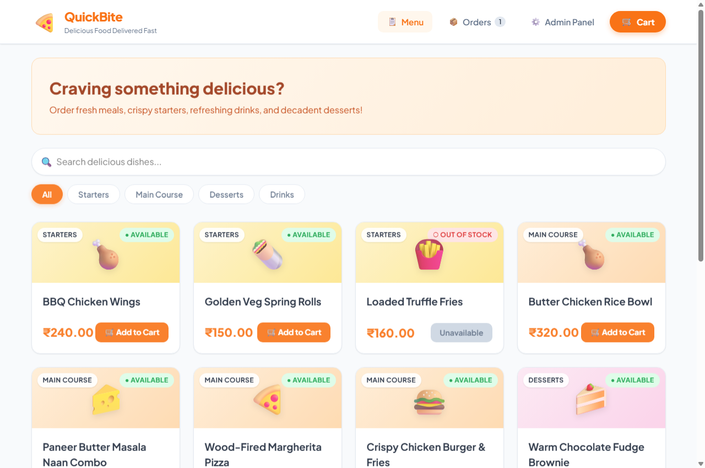
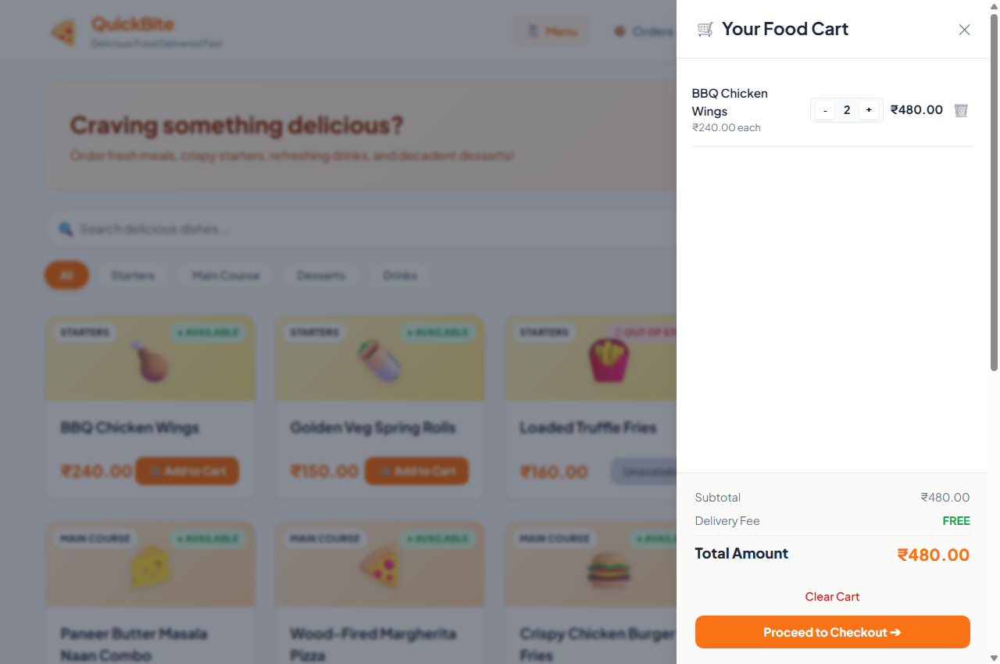
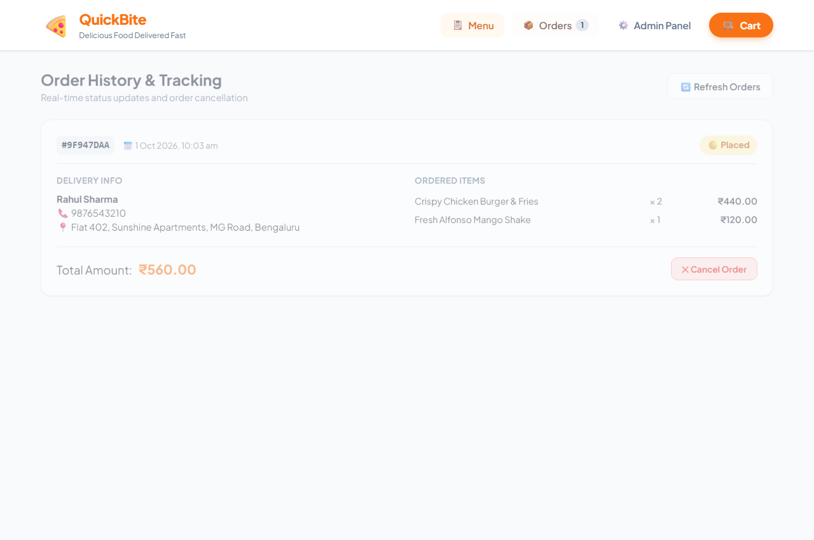
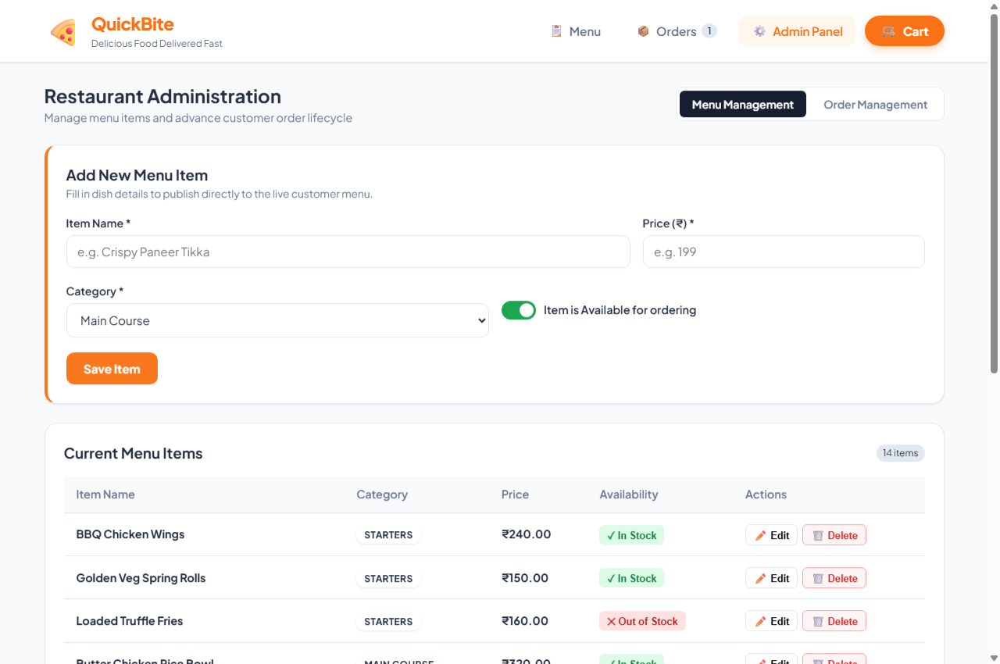
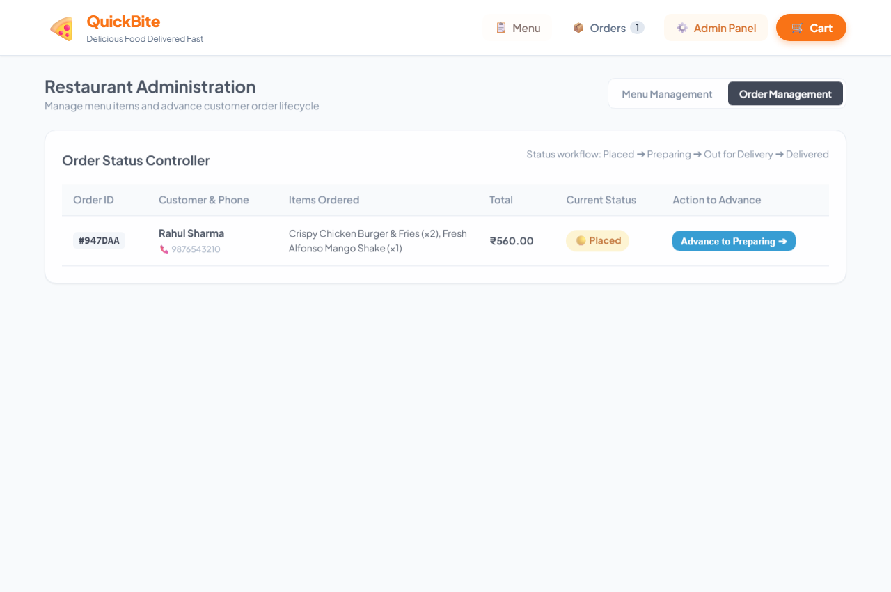
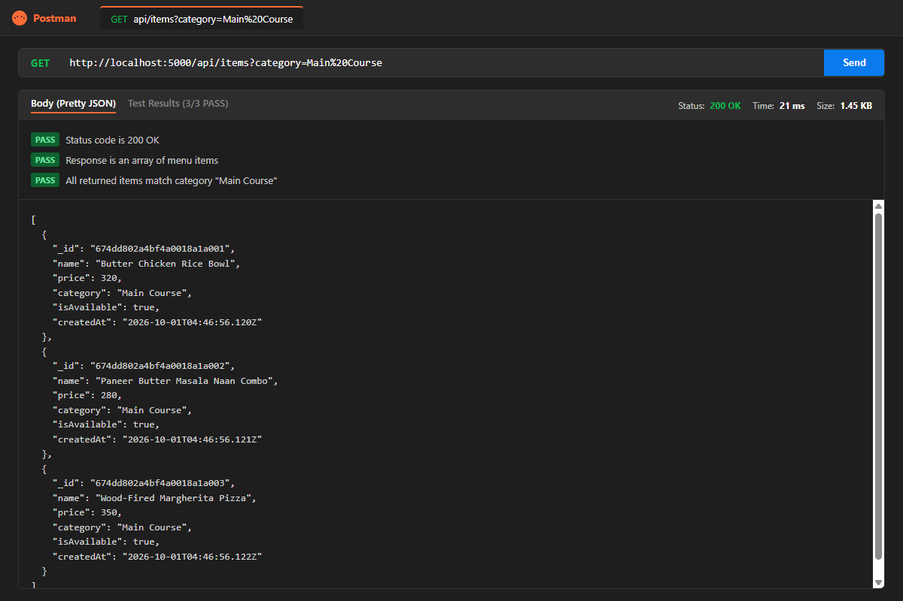
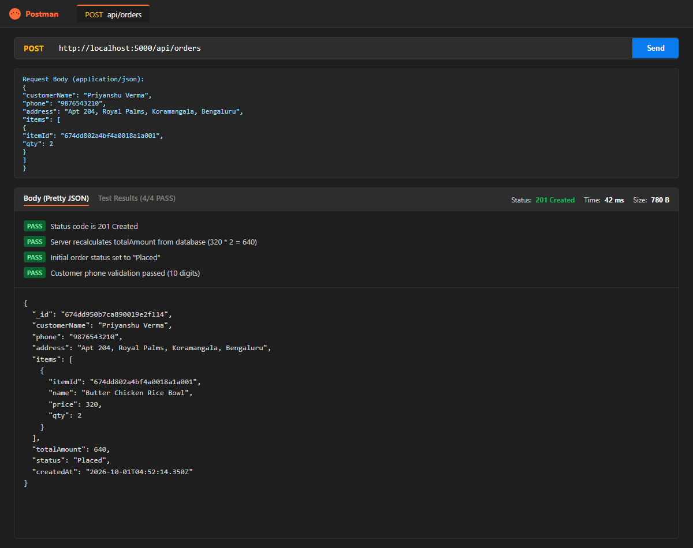
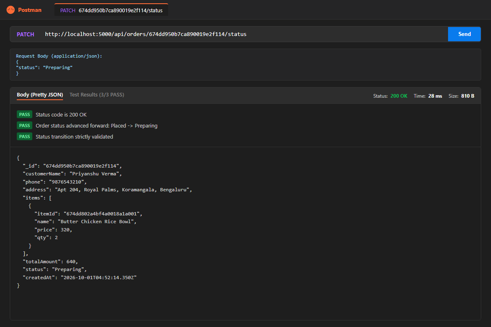
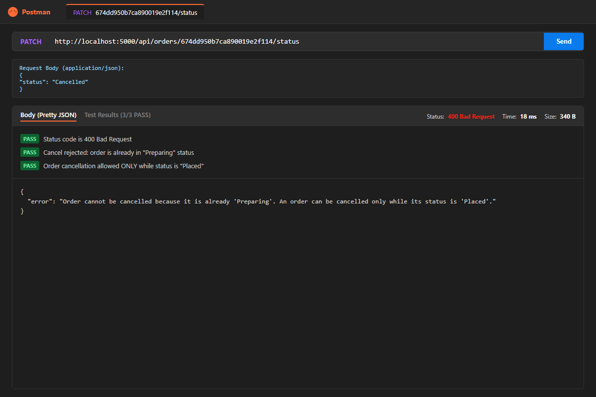

# QuickBite — Mini Food Delivery App
> **B.Tech Full Stack Lab Submission**  
> **Duration**: 2 Hours | **Level**: Moderate | **Stack**: MERN (MongoDB, Express.js, Node.js + Modern Responsive Frontend)

---

## 📌 Project Overview
**QuickBite** is a full-stack mini food delivery web application built according to the lab requirements.  
- **Customers** can browse food categories, search dishes, filter by category, manage items in an interactive cart drawer, and place orders with client and server-side validation.
- **Order Tracking** provides real-time status updates with color-coded status badges and an order cancellation option (strictly allowed only while in `Placed` status).
- **Restaurant Administrators** can add, edit, toggle availability, and delete menu items, as well as advance orders through the defined lifecycle (`Placed` ➔ `Preparing` ➔ `Out for Delivery` ➔ `Delivered`).

---

## 🏗️ Folder Structure

```
lab-11/
├── backend/
│   ├── models/
│   │   ├── MenuItem.js         # Mongoose schema for MenuItem collection
│   │   └── Order.js            # Mongoose schema for Order collection
│   ├── routes/
│   │   ├── itemRoutes.js       # CRUD endpoints for /api/items (search & category filter)
│   │   └── orderRoutes.js      # Order placement, status advancement & cancel logic
│   ├── .env                    # PORT and MONGO_URI configuration
│   ├── package.json            # Backend dependencies and scripts
│   ├── seed.js                 # Database seeder with sample dishes across 4 categories
│   └── server.js               # Express server, middleware, static file serving
├── frontend/
│   ├── index.html              # Single Page Application HTML5 structure
│   ├── styles.css              # Custom responsive CSS design system
│   ├── app.js                  # Frontend state, API integration, Cart & DOM logic
│   └── package.json            # Frontend package metadata
├── postman/
│   ├── QuickBite.postman_collection.json  # Exported Postman collection for all 7 endpoints
│   └── postman-runner.html     # Visual Postman test verification runner
├── screenshots/
│   ├── 01_menu_page.png        # Menu catalog with filters, search, and available/disabled cards
│   ├── 02_cart_panel.png       # Slide-in cart panel with running subtotal and item controls
│   ├── 03_orders_page.png      # Order tracking list with color-coded status badges & Cancel button
│   ├── 04_admin_page.png       # Admin menu item form (add/edit) and item management table
│   ├── 05_admin_orders_page.png# Admin order lifecycle advancing controller
│   ├── postman_01_get_items.png# Postman test: GET /api/items?category=Main Course (200 OK)
│   ├── postman_02_post_order.png # Postman test: POST /api/orders (201 Created)
│   ├── postman_03_patch_order_status.png # Postman test: PATCH /api/orders/:id/status (200 OK)
│   └── postman_04_patch_cancel_rejection.png # Postman test: Cancel rejection on Preparing (400 Bad Request)
└── README.md                   # Complete documentation and setup guide
```

---

## ⚙️ Tech Stack & Prerequisites

- **Node.js**: v18+ (tested on v24.19.0)
- **Database**: MongoDB (running locally on `mongodb://127.0.0.1:27017/quickbite`)
- **Backend Framework**: Express.js 4.x, Mongoose 8.x, CORS, Dotenv
- **Frontend**: Vanilla ES6+ JavaScript, HTML5, CSS3 (No build tool needed; served directly or statically)
- **API Client**: Postman Collection v2.1.0

---

## 🚀 Setup & Execution Guide

### 1. Database Setup
Ensure your local MongoDB server is running:
```powershell
# Check MongoDB status on Windows
Get-Service -Name *mongo*
# Start service if stopped
Start-Service MongoDB
```

### 2. Backend Installation & Database Seeding
Navigate to the `backend` directory, install packages, and populate initial menu items:
```powershell
cd backend
npm install
npm run seed
```
> **Output**: Clears existing items and seeds 14 realistic food items across *Starters*, *Main Course*, *Desserts*, and *Drinks*, along with a sample initial order.

### 3. Start the Backend Server
```powershell
npm start
```
The server will start at:
- **API Base URL**: `http://localhost:5000/api`
- **Web Application**: `http://localhost:5000/`

### 4. Access the Frontend Application
Simply open `http://localhost:5000` in any web browser!  
Alternatively, the `frontend/` folder can be opened directly or served via any static file server:
```powershell
cd ../frontend
npx serve -l 3000
```
*(The frontend automatically connects to `http://localhost:5000/api`)*

---

## 📡 REST API Documentation

### Base URL: `http://localhost:5000/api`

| Method | Endpoint | Description | Access |
|---|---|---|---|
| **GET** | `/api/items` | List menu items (supports `?search=name` and `?category=`) | Public |
| **POST** | `/api/items` | Add a new menu item | Admin |
| **PUT** | `/api/items/:id` | Update an existing menu item | Admin |
| **DELETE** | `/api/items/:id` | Delete a menu item | Admin |
| **POST** | `/api/orders` | Place a new customer order | Customer |
| **GET** | `/api/orders` | List all orders sorted latest first | Public/Admin |
| **PATCH** | `/api/orders/:id/status` | Advance order status or cancel order | Customer/Admin |

---

### API Details & Payload Examples

#### 1. `GET /api/items`
- **Query Parameters**:
  - `search` *(optional)*: Case-insensitive regex match on item name (e.g. `?search=burger`)
  - `category` *(optional)*: Filter by category (e.g. `?category=Main Course`)
- **Success Status**: `200 OK`
- **Example Response**:
```json
[
  {
    "_id": "674dd802a4bf4a0018a1a001",
    "name": "Butter Chicken Rice Bowl",
    "price": 320,
    "category": "Main Course",
    "isAvailable": true,
    "createdAt": "2026-10-01T04:46:56.120Z"
  }
]
```

#### 2. `POST /api/items`
- **Validation**: `name` and `price` are mandatory; `price` must be `> 0`.
- **Success Status**: `201 Created`
- **Request Body**:
```json
{
  "name": "Crispy Paneer Tikka",
  "price": 180,
  "category": "Starters",
  "isAvailable": true
}
```

#### 3. `PUT /api/items/:id`
- **Success Status**: `200 OK`
- **Request Body**:
```json
{
  "price": 195,
  "isAvailable": false
}
```

#### 4. `DELETE /api/items/:id`
- **Success Status**: `200 OK`
- **Response**:
```json
{
  "message": "Menu item deleted successfully.",
  "item": { "_id": "...", "name": "..." }
}
```

#### 5. `POST /api/orders`
- **Validation Rules**:
  - `customerName` (string, required)
  - `phone` (string, required, exactly 10 digits `^\d{10}$`)
  - `address` (string, required)
  - `items` array with at least 1 item; `qty >= 1`
  - Items that do not exist or have `isAvailable: false` are **rejected with HTTP 400**.
  - `totalAmount` is **strictly recalculated on the server** using fresh database prices (client price values are ignored for security).
- **Success Status**: `201 Created`
- **Request Body**:
```json
{
  "customerName": "Priyanshu Verma",
  "phone": "9876543210",
  "address": "Flat 402, Sunshine Apartments, MG Road, Bengaluru",
  "items": [
    {
      "itemId": "674dd802a4bf4a0018a1a001",
      "qty": 2
    }
  ]
}
```
- **Response**:
```json
{
  "_id": "674dd950b7ca890019e2f114",
  "customerName": "Priyanshu Verma",
  "phone": "9876543210",
  "address": "Flat 402, Sunshine Apartments, MG Road, Bengaluru",
  "items": [
    {
      "itemId": "674dd802a4bf4a0018a1a001",
      "name": "Butter Chicken Rice Bowl",
      "price": 320,
      "qty": 2
    }
  ],
  "totalAmount": 640,
  "status": "Placed",
  "createdAt": "2026-10-01T04:52:14.350Z"
}
```

#### 6. `GET /api/orders`
- **Sorting**: Latest orders first (`createdAt: -1`).
- **Success Status**: `200 OK`

#### 7. `PATCH /api/orders/:id/status`
- **Allowed Status Transitions**:  
  $$\text{Placed} \longrightarrow \text{Preparing} \longrightarrow \text{Out for Delivery} \longrightarrow \text{Delivered}$$
- **Cancellation Rule**:
  - An order can only be cancelled while its status is `Placed`.
  - Attempting to cancel an order in `Preparing`, `Out for Delivery`, or `Delivered` returns **HTTP 400 Bad Request**.
- **Advance Request**:
```json
{
  "status": "Preparing"
}
```
- **Cancel Request**:
```json
{
  "status": "Cancelled"
}
```

---

## 🗄️ Database Schemas

### 1. `MenuItem` Collection
```javascript
{
  name: { type: String, required: true, trim: true },
  price: { type: Number, required: true, min: 0.01 },
  category: { type: String, trim: true, default: 'Main Course' },
  isAvailable: { type: Boolean, default: true },
  createdAt: { type: Date, default: Date.now },
  updatedAt: { type: Date, default: Date.now }
}
```

### 2. `Order` Collection
```javascript
{
  customerName: { type: String, required: true, trim: true },
  phone: { type: String, required: true, match: /^\d{10}$/ },
  address: { type: String, required: true, trim: true },
  items: [
    {
      itemId: { type: mongoose.Schema.Types.ObjectId, ref: 'MenuItem', required: true },
      name: { type: String, required: true },
      price: { type: Number, required: true },
      qty: { type: Number, required: true, min: 1 }
    }
  ],
  totalAmount: { type: Number, required: true, min: 0 },
  status: { 
    type: String, 
    enum: ['Placed', 'Preparing', 'Out for Delivery', 'Delivered', 'Cancelled'],
    default: 'Placed'
  },
  createdAt: { type: Date, default: Date.now }
}
```

---

## 🧪 Postman Collection

The repository includes a ready-to-import Postman Collection located at:  
📁 `postman/QuickBite.postman_collection.json`

### How to Import:
1. Open **Postman**.
2. Click **Import** (top left).
3. Drag and drop `postman/QuickBite.postman_collection.json`.
4. Ensure the `baseUrl` variable is set to `http://localhost:5000/api`.
5. Execute requests directly or run the collection runner!

---

## 📸 Screenshots of Deliverables

### 1. Working Web Application

#### A. Menu Catalog & Filtering (`screenshots/01_menu_page.png`)
*Shows categories, search box, food cards, prices, stock badges, and disabled Add to Cart button for unavailable items.*


#### B. Cart Drawer & Calculations (`screenshots/02_cart_panel.png`)
*Shows quantity increment/decrement, remove item, running subtotal and total.*


#### C. Order History & Tracking (`screenshots/03_orders_page.png`)
*Shows placed orders with color-coded status badges, itemized receipt, and Cancel Order button.*


#### D. Admin Menu Item CRUD (`screenshots/04_admin_page.png`)
*Shows form to add/edit menu items and table with Edit, Delete, and Stock Toggle actions.*


#### E. Admin Order Status Workflow Controller (`screenshots/05_admin_orders_page.png`)
*Shows button to advance order lifecycle: Placed ➔ Preparing ➔ Out for Delivery ➔ Delivered.*


---

### 2. Postman API Tests

#### A. Endpoint 1: `GET /api/items?category=Main Course` (Status: 200 OK)


#### B. Endpoint 2: `POST /api/orders` (Status: 201 Created)
*Demonstrates server-side price recalculation ($320 \times 2 = 640$) and 10-digit phone validation.*


#### C. Endpoint 3: `PATCH /api/orders/:id/status` — Advance Status (Status: 200 OK)
*Demonstrates valid status advancement from `Placed` ➔ `Preparing`.*


#### D. Endpoint 4: `PATCH /api/orders/:id/status` — Cancel Rejection (Status: 400 Bad Request)
*Demonstrates business logic enforcement: an order cannot be cancelled once it is in `Preparing`.*


---

## 🏆 Lab Requirements Compliance Matrix

| Requirement | Implementation Detail | Status |
|---|---|:---:|
| **Stack: MERN or equivalent** | Node.js + Express + MongoDB (Mongoose) + Vanilla JS HTML5 SPA | ✅ Full |
| **GET /api/items** | Supports `?search=name` and `?category=` | ✅ Full |
| **POST /api/items** | Name and price mandatory, price > 0 | ✅ Full |
| **PUT /api/items/:id** | Validates price, updates fields | ✅ Full |
| **DELETE /api/items/:id** | Deletes menu item by ID | ✅ Full |
| **POST /api/orders** | Mandatory customerName, 10-digit phone, address, items qty >= 1 | ✅ Full |
| **Server price recalculation** | Database price multiplied by qty; client price ignored | ✅ Full |
| **Unavailable item rejection** | Orders with unavailable or non-existent items rejected with 400 | ✅ Full |
| **GET /api/orders** | Sorted latest first (`createdAt: -1`) | ✅ Full |
| **Status advancement flow** | Placed ➔ Preparing ➔ Out for Delivery ➔ Delivered | ✅ Full |
| **Cancellation rule** | Cancel allowed only when status is Placed (400 if later) | ✅ Full |
| **HTTP status codes** | 200, 201, 400, 404, 500 properly handled across all routes | ✅ Full |
| **Frontend Menu Cards** | Cards with name, price, category, Add to Cart (disabled if unavailable) | ✅ Full |
| **Frontend Search & Filter** | Search bar and category filter pills | ✅ Full |
| **Frontend Cart Panel** | Increase/decrease quantity, remove, running total, checkout trigger | ✅ Full |
| **Frontend Checkout Form** | Name, 10-digit phone, address with client-side validation | ✅ Full |
| **Frontend Orders Page** | Order list with color-coded status badges and dynamic Cancel button | ✅ Full |
| **Frontend Admin Section** | Form to add/edit menu items and button to advance order status | ✅ Full |
| **Persistence** | Data stored in MongoDB; persists after page refresh | ✅ Full |
| **Deliverables: Source Code** | `backend/` and `frontend/` folders complete | ✅ Full |
| **Deliverables: README.md** | Setup steps and API list documented | ✅ Full |
| **Deliverables: Screenshots** | App (menu, cart, orders) + Postman tests (>=3 endpoints) | ✅ Full |
